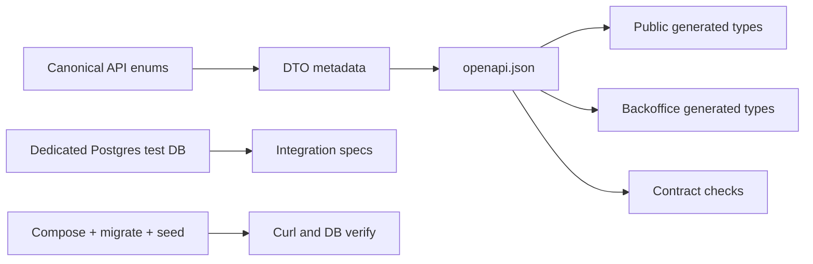

# Contract and Test Pyramid Design

**Spec:** `.specs/features/contract-and-test-pyramid/spec.md`  
**Status:** Approved

## Architecture

## Reuse

| Existing asset | Use |
| --- | --- |
| `api/src/main.ts` Swagger setup | Extract reusable document/application factories. |
| `api/scripts/ensure-database.ts` and migrations | Create and migrate the dedicated integration DB. |
| `verification/scripts/*` | Preserve curl assertions and harden orchestration/idempotency. |
| Public architecture/route helpers | Single presentation translation boundary. |
| Existing DTO response classes | Populate OpenAPI response schemas before generation. |

## Components

- **Canonical enums:** API common enums imported by DTOs, seeds, services, repository types, and public response types.
- **OpenAPI generator:** creates the Nest app without listening, writes deterministic JSON, and closes cleanly.
- **Coverage audit:** enumerates frontend-consumed methods and validates typed response schemas, including intentional string/void/nullable cases.
- **Per-app generator:** `openapi-typescript` output committed under each app’s `core/api/generated` directory; handwritten models become aliases/adapters only.
- **Contract gate:** regenerates/checks OpenAPI plus schema/mapper fixtures.
- **Integration harness:** explicit test environment, migration setup, safe cleanup, serialized SQL specs.
- **Verify runner:** compose health, migration/seed, curl assertions, DB assertions, and clear environment diagnostics.

## Technical decisions

| Decision | Choice | Rationale |
| --- | --- | --- |
| Contract distribution | Per-app generated types | No workspace/package layer is needed. |
| Integration DB | Compose Postgres, dedicated DB | Reuses the stack and avoids mock-only confidence. |
| Contract spec style | Runner-agnostic globals | Survives Jest→Vitest. |
| Domain values | String enums/const sources in API | Matches persisted/runtime spellings. |
| Public labels | Central helpers | Keeps presentation synonyms out of the contract. |

## Error handling

| Failure | Handling |
| --- | --- |
| Unsafe integration DB target | Refuse setup/cleanup with an actionable error. |
| Missing response schema | Contract coverage check fails with method/path. |
| Stale generated output | Check command exits non-zero. |
| Verify prerequisite unavailable | Fail early with required command/env/service. |
