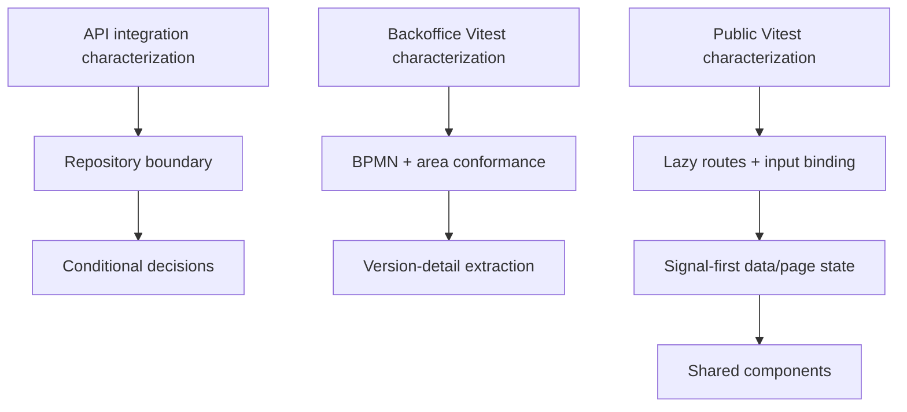

# Platform Conformance Refactor Design

**Spec:** `.specs/features/platform-conformance-refactor/spec.md`  
**Status:** Approved

## Architecture

## Method

For each change point: identify a test point, break hard dependencies only as needed, write characterization tests, refactor one goal at a time, compile/test, then run critical-flow verification. Preserve public signatures where practical and let TypeScript expose missed consumers.

## Components and seams

- **API repository:** owns procedure-existence and procedure/asset clone SQL; service retains workflow validation and transaction orchestration. Health probe SQL remains intentional.
- **Backoffice BPMN/area:** signal inputs and component host listeners; route input/signals replace snapshot loading while preserving calls and UI states.
- **Version detail:** extract template-focused children (lifecycle, asset/revisions, procedure, history/audit) before moving load orchestration behind a focused facade.
- **Public shell:** lazy standalone routes plus component input binding, with route behavior characterized.
- **Public data/pages:** stable signal-first state and teardown; use `httpResource` only if its Angular 20 behavior proves appropriate.
- **Public shared:** signal inputs and host metadata/directives for breadcrumbs, BPMN, and catalog search.

## Decisions

| Decision | Choice | Rationale |
| --- | --- | --- |
| Sequence | Contract → Vitest/characterization → refactor per app | Avoids writing new safety tests in an obsolete runner. |
| Bug fixes | Allowed only as isolated explicit commits | User-approved deviation from strict behavior-only refactoring. |
| Version-detail order | Template children before orchestration facade | Lowers shared-state risk progressively. |
| Experimental data API | Evaluate; stable fallback permitted | Conformance must not trade stability for novelty. |

## Failure controls

- Stop a refactor step on any test/build/verify regression.
- Do not change characterization assertions during the matching implementation step.
- Record environmental inability to run compose verification separately from code failures.
- Record every conditional/deferred item in the spec with a concrete rationale.
