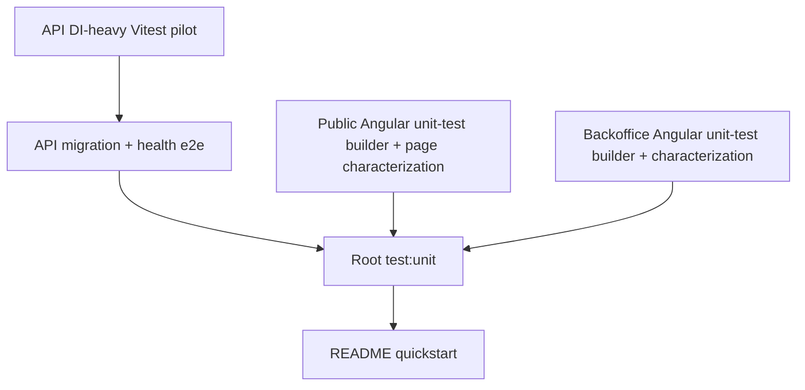

# Vitest Standardization Design

**Spec:** `.specs/features/vitest-standardization/spec.md`  
**Status:** Approved

## Architecture

## Reuse

- API keeps `@nestjs/testing`, SWC-compatible decorator transforms, reflection setup, and existing specs.
- Angular uses the installed `@angular/build` unit-test builder with Vitest/jsdom.
- Existing 352 assertions form the no-regression floor; new page/BPMN/area specs increase it.

## Decisions

| Decision | Choice | Rationale |
| --- | --- | --- |
| API transform | Validate a DI-heavy pilot before codemod | Proves decorator metadata, not only trivial TypeScript. |
| Angular migration | `@angular/build:unit-test` | Framework-supported integration. |
| Sequence | Keep old runner until package green | Gives a trustworthy fallback. |
| E2E | Vitest + Supertest health/bootstrap | Repairs stale isolated Jest config. |
| Cleanup | Remove old dependencies only after green | Avoids premature rollback loss. |

## Characterization targets

- Public: process list/detail, procedure detail, glossary, route/query behavior.
- Backoffice: area-detail loading and broader version-detail loading/action/failure/tab/procedure/history behavior.
- Shared components touched later: BPMN viewer and route normalization where browser APIs need fakes.
