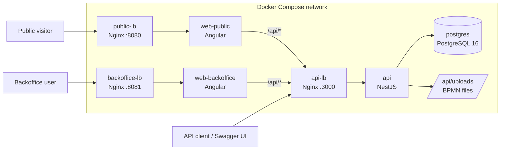

# Process Management System

[](LICENSE)
[](https://github.com/nestjs/nest)
[](https://github.com/angular/angular)
[](https://github.com/postgres/postgres)
[](https://github.com/docker/compose)
[](https://github.com/vitest-dev/vitest)
[](https://github.com/microsoft/playwright)

A web platform for documenting, governing, and publishing an organization's business processes, built on the COBIT 2019 IT governance framework. Processes are authored, reviewed, approved, and then shared with everyone through a public portal.

## About

Content is organized as Area → Process → Procedure. Every Process is stored as a **Process Version** that moves through a controlled lifecycle (`Draft` → `In Review` → `Approved` → `Published` → `Archived`). Each version can carry a Business Process Model and Notation (BPMN) diagram and be described in two architecture states: `AS-IS` (shown as "Current State") and `TO-BE` (shown as "Target State").

The system replaces a static portal that went offline for unknown reasons, was refreshed only by an overnight batch import, and had an unmaintained, non-versioned codebase. PMS addresses each of these:

- Current content: the portal reads published content straight from the API, with no batch import delay.
- Trust: only `Published` versions are public. Every change passes through role-separated review and approval, and every state transition is recorded in an audit log.
- Resilience: the database, API, and both web apps run as independent services behind Nginx entrypoints, and the application tier scales horizontally.
- Maintainability: an open-source TypeScript stack with an OpenAPI contract, generated frontend types, and layered automated tests.

## Architecture



*Figure 1. Runtime architecture in Docker Compose. Users reach each app through its Nginx load balancer, and both web apps call the API through `api-lb`. Only the API talks to PostgreSQL and the BPMN upload folder.*

| Service | Role |
| --- | --- |
| `api` | NestJS REST API with JWT auth, role-based access control, workflow rules, and the audit trail. |
| `web-public` | Angular public portal for published content. |
| `web-backoffice` | Angular backoffice for authenticated governance and administration. |
| `postgres` | Single PostgreSQL instance, persisted in the `pgdata` volume. |
| `*-lb` | Nginx load balancers that stay the public entrypoints when services are scaled. |

Ports, roles, the content model, and the lifecycle diagram are in the [architecture guide](docs/architecture.md).

## Quick start

You need [Docker Desktop](https://www.docker.com/products/docker-desktop/) (or Docker Engine) with `docker compose`, and free ports `3000`, `8080`, `8081`, and `5431`. On Windows, run the commands in PowerShell or Git Bash. Node.js is not required.

```bash
cp .env.example .env
docker compose up -d --build
docker compose run --rm api npm run migrate
docker compose run --rm api npm run seed
```

The default values in `.env` work for a local demo without edits. Change `DB_PASSWORD`, `JWT_SECRET`, `PASSWORD_PEPPER`, and `DEMO_USER_PASSWORD` before sharing the stack.

Then open:

| App | URL |
| --- | --- |
| Public portal | <http://localhost:8080> |
| Backoffice | <http://localhost:8081> |
| Swagger UI | <http://localhost:3000/docs> |
| API health | <http://localhost:3000/health> |

Sign in to the backoffice using the password from `DEMO_USER_PASSWORD` in `.env` with any seeded account:

- `alice.editor@example.com` (`EDITOR`)
- `rachel.reviewer@example.com` (`REVIEWER`)
- `peter.publisher@example.com` (`PUBLISHER`)
- `victor.viewer@example.com` (`VIEWER`)
- `sam.admin@example.com` (`SYSTEM_ADMIN`)

Run `docker compose down` to stop the stack and keep your data, or `docker compose down -v` to also delete the database.

## Documentation

- [Development guide](docs/development.md): hot-reload setup, migrations, tests, and diagnostics.
- [Operations guide](docs/operations.md): scaling, resets, and troubleshooting.
- [Architecture guide](docs/architecture.md): services, content model, lifecycle, and roles.
- [Scope](docs/scope.md), [business rules](docs/business-rules.md), [user roles](docs/user-roles.md), and [technical specification](docs/technical-specification.md): requirements and COBIT traceability.
- [Contributor contract](AGENTS.md) and [testing strategy](.specs/codebase/TESTING.md): read these before contributing.

## License

Released under the [MIT License](LICENSE).
