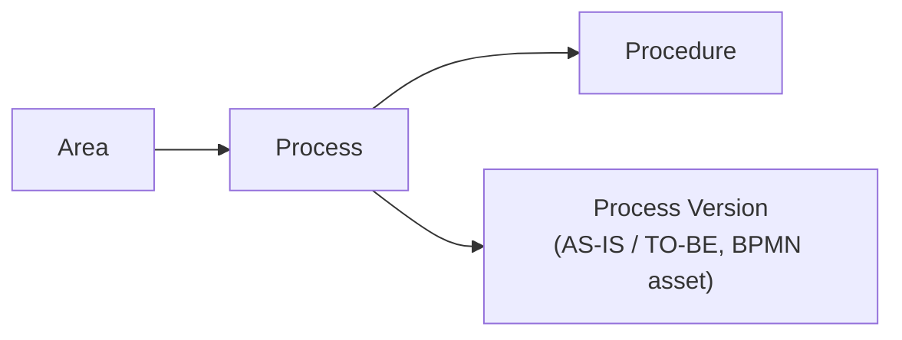
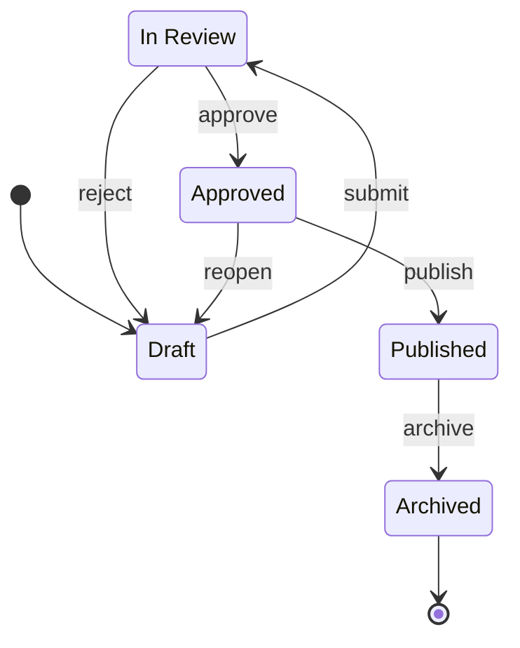

# Architecture

This guide expands the architecture summary in the [README](../README.md).

## Services

| Service | Technology | Exposed at | Responsibility |
| --- | --- | --- | --- |
| `postgres` | PostgreSQL 16 | `localhost:5431` (`DB_PORT`) | Single persistent relational store, backed by the `pgdata` volume. |
| `api` | NestJS 11, TypeORM | internal `:3000` | JWT auth, RBAC, workflow rules, audit trail, Swagger, public catalog endpoints, BPMN asset storage. |
| `api-lb` | Nginx | <http://localhost:3000> | Public entrypoint and load balancer for `api` replicas. |
| `web-public` | Angular 20, served by Nginx | internal `:8080` | Public portal for published areas, processes, procedures, BPMN diagrams, search, and glossary. |
| `public-lb` | Nginx | <http://localhost:8080> | Public entrypoint and load balancer for `web-public` replicas. |
| `web-backoffice` | Angular 20, served by Nginx | internal `:8080` | Authenticated governance and administration UI. |
| `backoffice-lb` | Nginx | <http://localhost:8081> | Public entrypoint and load balancer for `web-backoffice` replicas. |
| `sonarqube` (optional) | SonarQube Community | <http://localhost:9000> | Local code-quality server, only started with the `diagnostics` profile. |

## How the pieces fit together

- Entrypoints: users only talk to the three load balancers. The application containers (`api`, `web-public`, `web-backoffice`) sit on the internal Docker network and can be scaled with `docker compose up -d --scale ...` without changing any URL.
- API access: each web app's Nginx proxies `/api/*` to `api-lb`, so the browser needs no separate API origin in Docker. When the Angular dev servers run on their own ports, the frontends call <http://localhost:3000>.
- State: only PostgreSQL (`pgdata` volume) and uploaded BPMN files (`./api/uploads`) hold state. PostgreSQL runs as a single instance.
- Contract: the API's OpenAPI document is the source of truth, and the frontend types are generated from it.

## Content model

*Figure 1. Content hierarchy. An Area contains Processes, a Process contains Procedures, and each Process is stored as governed Process Versions.*

## Process Version lifecycle

*Figure 2. Process Version lifecycle. Rejection returns a version from `In Review` to `Draft`, and an approved version can be reopened to `Draft`. Those are the only backward transitions.*

Only `Draft` versions are editable, and only `Published` versions appear in the public portal. The complete rules are in [business-rules.md](business-rules.md) and [user-roles.md](user-roles.md).

## Roles

| Role | Responsibility |
| --- | --- |
| `EDITOR` | Draft processes, procedures, and versions, and upload BPMN diagrams. |
| `REVIEWER` | Review submitted versions, then approve or reject them. |
| `PUBLISHER` | Publish approved versions and archive outdated ones. |
| `VIEWER` | Read non-public governance content in the backoffice. |
| `SYSTEM_ADMIN` | Manage users and teams. |

Anyone can read published content in the public portal without signing in.

## Features

- JWT login, role-based access control, and protected backoffice routes
- CRUD for users, teams, glossary terms, areas, processes, versions, assets, and procedures
- Process Version lifecycle with enforced transitions, an audit log, and state history
- BPMN upload with checksum validation, and in-browser BPMN viewing
- Public catalog under `/public/*`, with search, glossary, and Current State / Target State comparison
- OpenAPI documentation (Swagger UI at `/docs`) and a `/health` endpoint
